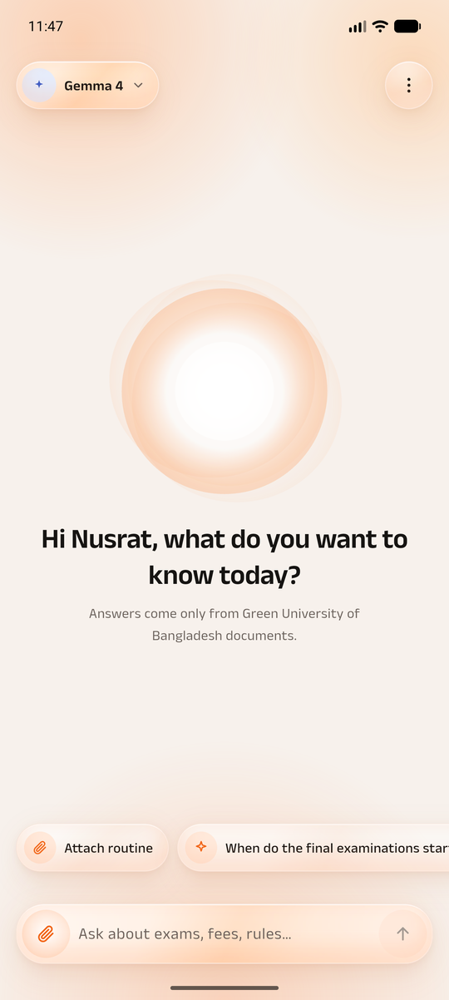
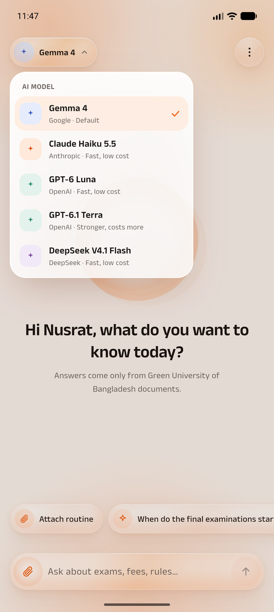
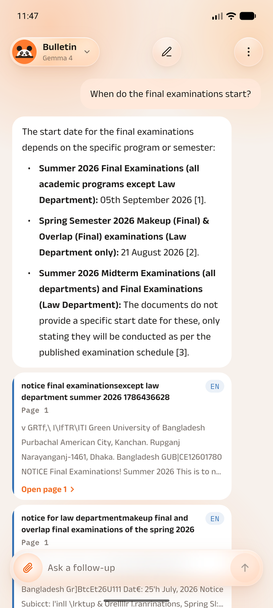
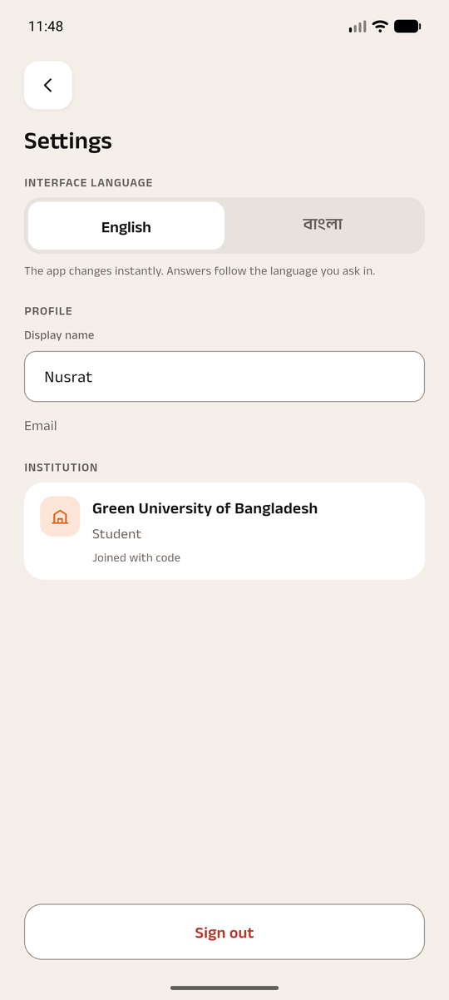
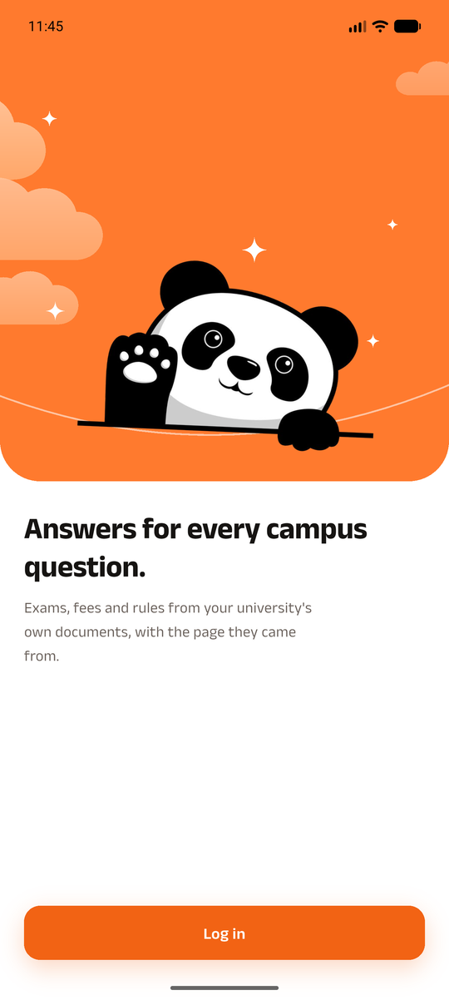
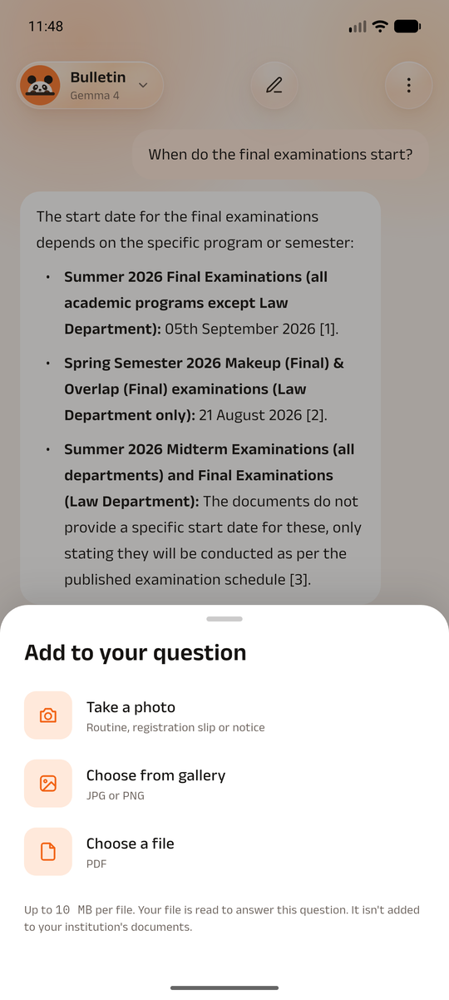

# Bulletin

**Your institution's bulletin, made askable — with the page to prove every answer.**

A bilingual (English/Bangla) retrieval system for university documents. An institution
publishes its academic calendar, exam routines, fee schedules and notices once; students
and teachers ask in either language — optionally attaching their own class routine — and
get answers grounded strictly in those documents, with page-level citations. Below the
retrieval score floor it says "not found" instead of inventing something.

FastAPI + pgvector backend, Flutter client, measured against a 62-question gold set.

<table>
  <tr>
    <td align="center"><br><sub>Launch</sub></td>
    <td align="center"><br><sub>Home</sub></td>
    <td align="center"><br><sub>Pick a model</sub></td>
    <td align="center"><br><sub>Cited answer</sub></td>
    <td align="center"><br><sub>Settings</sub></td>
  </tr>
</table>

---

## Contents

- [Highlights](#highlights)
- [The app](#the-app)
- [Status](#status)
- [The thesis](#the-thesis)
- [What has actually been measured](#what-has-actually-been-measured)
- [Correctness boundaries](#correctness-boundaries)
- [Findings](#findings)
- [Architecture](#architecture)
- [Stack](#stack)
- [Running it](#running-it)
- [Layout](#layout)
- [What is not done](#what-is-not-done)

## Highlights

- **Answers with the page to prove them.** Every answer carries numbered citations that open
  a source card with the document title and page. No source above the floor, no answer.
- **Bilingual end to end.** Ask in English or Bangla about a document in either. Bangla
  normalization is one function shared by ingestion and query, and every screen is asserted
  at 200% text scale in Bangla.
- **Cross-lingual retrieval that is measured, not assumed.** Hybrid dense + lexical search
  fused by reciprocal rank, with query translation as a second mitigation, compared on a gold
  set that includes 15 unanswerable questions.
- **Personal files stay personal.** A student can attach a class routine photo to ask "which
  of my exams are this week?". It is read for that question only and can never enter the
  shared index. The extracted course codes must be confirmed by the user before any answer.
- **Choose the model.** Five cheap models behind a server-side allow-list, switchable from the
  top bar. The app only ever sends a short key; the OpenRouter id never leaves the server.
- **Row-level security everywhere**, with the audience filter inside the SQL query.

## The app

A redesign in orange with a panda that waves at launch. Built on Riverpod with
`data / domain / presentation` feature folders and a sealed `Result` type, so no network call
throws across a layer.

<table>
  <tr>
    <td align="center"><br><sub>Welcome, after the launch animation</sub></td>
    <td align="center"><br><sub>Attach: camera, gallery or file</sub></td>
    <td align="center"><br><sub>Settings</sub></td>
  </tr>
</table>

- **Launch animation.** A panda peeks over a ledge, waves, and the wordmark fades up while
  clouds drift. It runs as one timeline on one controller, so it stays in step on a slow
  phone. Returning users get a shorter version. The
  [full recording](docs/media/splash.mp4) is in the repo.
- **Model picker.** The pill at the top left shows the current model and opens a menu of five:
  Gemma 4 (the default, and the one the eval measures), Claude Haiku 5.5, GPT-6 Luna,
  GPT-6.1 Terra (about ten times the cost, and labelled so), and DeepSeek V4.1 Flash. The server
  validates the key and refuses an unknown one with a 422 before spending a token. The menu
  adds no blur, because the budget is two `BackdropFilter`s per screen.
- **Settings.** Pushed with a custom route (the screen below slides to -30% under a scrim,
  with an edge-swipe back that commits past 35% or 800 px/s). Interface language, display name
  saved through `PATCH /me`, institution and role, and sign out. The language and the model
  you picked are remembered.
- **Attach sheet.** Camera, gallery or file, with the 10 MB limit and the privacy line
  stated where the choice is made.

The screenshots are of a test account against a real Supabase project, answering from the
public notices of one university. Personal details in them are masked.

## Status

This is an in-progress thesis project. The numbers below are real and reproducible; the
gaps are named rather than hidden.

| | |
|---|---|
| Backend pipeline, API, streaming | complete — 391 tests |
| Flutter client | splash, auth, join, home, model picker, chat with citations, attachments, settings — 126 tests. Chat-thread redesign, source viewer and the admin screens pending |
| Cross-lingual verification (Strategy A premise) | **measured — passes** |
| Strategy B implementation | complete, 22 tests |
| **Ablation A — the headline result** | **not run.** Blocked on a real bilingual corpus |
| Corpus | live database: 15 public notices from one university (71 chunks). The measurements below were taken on an earlier set of 9 documents and 52 chunks. Both are too small, and collection is the active blocker |

The honest summary: the machinery is built and tested, and the one measurement that
would make or break the whole approach has been taken and passed. The comparative
ablation that constitutes the thesis result needs a corpus that does not exist yet.

---

## The thesis

**Language mismatch between question and source is a silent retrieval failure.**

In a mixed-language corpus, cross-lingual retrieval — not generation quality, not model
size — is the binding constraint. And it degrades with no error signal: no exception, no
warning, just a confident "not found."

The mechanism is concrete. Hybrid search fuses a dense arm (embeddings) with a lexical
arm (BM25 / trigram). An English query and a Bangla chunk share **zero tokens**, so the
lexical arm returns empty and the search silently collapses to dense retrieval alone —
precisely on the corpus where dense is least reliable, because Bangla PDFs in this region
frequently use legacy ASCII-mapped fonts that extract as garbage.

Two mitigations are implemented and measured against each other:

- **Strategy A — shared embedding space.** Trust a cross-lingual model to place
  equivalents near each other.
- **Strategy B — query translation.** Translate the query and run both arms again,
  buying the lexical arm back for one round trip.

---

## What has actually been measured

### The premise behind everything: is the embedding model really cross-lingual?

Twenty domain sentence pairs (exam dates, hostel rules, fees, registration), embedded
with `baai/bge-m3`. The headline metric is deliberately **rank**, not raw cosine
similarity — some models put every pair at 0.9 and every unrelated pair at 0.85, which
looks excellent and retrieves nothing.

> For each English sentence, is its true Bangla translation the nearest of all 20 Bangla
> candidates? That is precisely the question retrieval asks.

| | |
|---|---|
| **Top-1 accuracy** | **100%** (floor: 70%) |
| Mean matched cosine | 0.8809 |
| Mean mismatched cosine | 0.4950 |
| **Margin** | **+0.3859** (floor: +0.05) |

Strategy A's premise holds. `eval/verify_crosslingual.py` · 40 embedding calls, run
before a single chunk was written.

### Ablation C — does the hybrid arm earn its complexity?

The PRD predicted dense retrieval would underperform badly on course codes, and that
this would justify the hybrid architecture. It does — but the margin is in **MRR**, not
Recall, which is a more interesting result than the one predicted.

| slice | n | dense | lexical | hybrid |
|---|---|---|---|---|
| course_code (MRR) | 12 | 0.74 | **0.94** | 0.92 |
| notice prose (MRR) | 23 | **0.98** | 0.93 | 0.95 |
| routine tables (MRR) | 12 | 0.92 | **0.96** | 0.90 |
| **ALL — Recall@5** | 47 | 0.98 | 0.98 | **1.00** |

Neither arm wins everywhere. Dense owns prose, lexical owns codes, and the fusion is the
only configuration that never loses a document.

### Gold set, 62 questions

| | |
|---|---|
| Recall@5 / MRR | 1.00 / 0.93 |
| Unanswerable questions refused | **15/15** |
| Answers that invented a fact | **0** |
| Answers containing the expected fact | 35/35 |

**Read Recall@5 = 1.00 with suspicion.** The index is 52 chunks. At that size almost any
retriever scores 1.00, and the number says more about the corpus than the system. The
refusal column is the one carrying weight: eight questions were stopped by the score
floor before any LLM call, and the answer prompt caught the remaining seven.

### Generation model comparison

Every candidate answered the **same retrieved context** through the **same answer
prompt**, so the only variable is the model.

| model | providers | $/1k questions | refusals | content | 429 failures |
|---|---:|---:|---:|---:|---:|
| `google/gemma-4-26b-a4b-it` | 8 | **$0.14** | 7/7 | 35/35 | **0** |
| `qwen/qwen3.8-flash` | **1** | $0.41 | 6/6 | 34/34 | **2** |

Both are qualitatively perfect on what they answered. The difference is availability —
see the findings below.

---

## Correctness boundaries

Four constraints that are enforced structurally rather than by convention, because each
one fails silently if it is merely documented:

**Chat attachments never enter the vector index.** A student's class routine is personal
and semester-scoped. Indexing it would place one student's schedule where another
student's query can retrieve it, with no audience tag that correctly describes it. The
`attachments` table has no embedding column, and a test asserts the attachment package
never imports the chunk writer.

**The audience filter lives in the SQL, not in post-processing.** Candidate chunks are
restricted by the caller's role *before* vector search. Post-filtering leaks through the
not-found boundary — a student learns a teacher-scoped document exists by the shape of
the refusal. A test asserts the `WHERE` clause precedes the `ORDER BY` and `LIMIT`.

**No answer from an attachment without confirmed entities.** OCR on an alphanumeric
course code fails silently: `CSE 3103` read as `CSE 3108` produces a confident answer
about the wrong exam, and no downstream stage can detect it. The user confirms the
extracted codes in an editable sheet first. Dismissing that sheet — swipe, back, cancel —
confirms nothing, and the API rejects an unconfirmed join with a 409.

**Below the retrieval score floor, the LLM is never called.** The gate is structural: the
plan returned in that case carries no messages, so there is nothing to send.

---

## Findings

Bugs worth recording, because each was invisible until measured.

**A model with one provider is a single point of failure.** Chat answers were dying as
"the answer could not be completed." Retrieval was fine — dense top score 0.624 against a
0.48 floor, five citations built. The failure was an upstream 429. Querying the provider
API explained why retrying never helped:

```
qwen/qwen3.8-flash   ->  1 provider   (Alibaba)
qwen/qwen3.8-27b     ->  11 providers (Chutes, Novita, CoreWeave, ...)
```

With one provider there is nowhere to route, so every retry queues for the same
saturated pool. A rate-limited model is not slow, it is *unavailable*, and the answer to
unavailable is a different model. Generation now walks a model chain, and the ordering is
the point: the whole chain is tried at full speed **before** any backoff.

**Retry policy protected the batch job and not the user.** The request path had backoff
since ingestion needed it; the streaming path — the one every chat answer takes — had
none. The fix retries only until the first token is emitted: a stream cannot be replayed,
and retrying after tokens have reached the phone would make the user watch the answer
write itself twice.

**Models localise citation markers in Bangla answers.** Asked to answer in Bangla, models
intermittently write `[১]` instead of `[1]`, which no longer matches any Source Card. It
appears across every model tested, and a prompt instruction did not reliably suppress it —
so it needs deterministic normalisation, not prompt tuning.

**A course-code guard that disabled itself.** The Strategy B validator rejects a
translation that drops a course code — `CSE 3103` becoming `সিএসই ৩১০৩` is correct Bangla
and a destroyed query. Writing its tests revealed the scanner also read `Fall 2026` as
the code `FALL 2026`, so every correct translation of a term-scoped question was being
rejected: Strategy B silently switching itself off on some of the most common questions
asked.

---

## Architecture

```
question
  ├─ condense against history        no history means no LLM call
  ├─ detect language                 selects the lexical index and the chunk budget
  ├─ normalize                       one function, shared with ingestion
  ├─ audience filter                 IN the query, never after
  ├─ dense (pgvector HNSW) + lexical (tsvector en / pg_trgm bn), 20 each
  │    └─ Strategy B: translate, run both arms again, fuse four lists
  ├─ reciprocal rank fusion
  ├─ rerank 20 → 5
  ├─ score floor gate                below it, return not-found without calling the LLM
  └─ generate + stream               citations event first, so cards render while text writes
```

Ingestion escalates rather than assuming: PyMuPDF text extraction, then a font-table
inspection that classifies each document as `native_text`, `legacy` or `scanned`. Legacy
ASCII-mapped Bangla is converted with a per-page confidence score; low confidence
escalates to a vision read of the rendered page. Every stage logs `doc_id`, `page_no` and
outcome, because silent failure is the enemy on this project.

Bangla normalization is a single function called by both ingestion and query. Asymmetry
there destroys retrieval with no error, so no call site is allowed to inline it.

---

## Stack

**Backend** — FastAPI, PostgreSQL + pgvector (Supabase), PyMuPDF, pydantic-settings.
Models through OpenRouter behind a provider interface; `data_collection: "deny"` on every
request, applied at one choke point so no call site can forget it.

**Client** — Flutter, Riverpod, Drift. Hand-written SSE decoder, because `Utf8Decoder`
per chunk corrupts any Bangla word split across a chunk boundary — a bug its test caught.
Fully bilingual: every string through l10n, and the text style is resolved *per string*,
since one sentence can hold both scripts.

**Security** — Row-level security on every table, an audience predicate on chunks, a
user predicate on attachments. The client holds the Supabase anon key and nothing else.

---

## Running it

```bash
cp .env.example .env          # fill in the keys
make dev                      # backend, reload
make extract-report           # encoding classification — run FIRST on a new corpus
make ingest                   # full pipeline
make eval                     # ablation tables → eval/reports/
make test                     # 391 tests

cd app && flutter run         # 126 tests via flutter test
```

On Windows without `make`, `.\make.cmd <target>` takes the same names. The Flutter app reads
`BULLETIN_SUPABASE_URL` and `BULLETIN_SUPABASE_ANON_KEY` as `--dart-define`s (the anon key only; the
service key never goes near the client) and reaches a local backend at `10.0.2.2:8000` from an
Android emulator. Run the backend without `--reload` on Windows: it reports reloading and keeps
serving the old code.

`make extract-report` before `make ingest` is not optional advice. Legacy-font documents
ingested without the converter index as garbage, with no error anywhere.

---

## Layout

```
backend/app/
  ingest/       extraction, encoding classification, vision escalation, chunking
  bangla/       normalize (single source of truth), legacy font conversion, segmentation
  retrieve/     dense, lexical, fusion, rerank, audience, translate_query
  attachments/  structured extraction, typed schemas, confirmed-code join
  generate/     condense, answer, score floor gate
  providers/    provider interface + OpenRouter implementation
eval/
  gold_set.jsonl            62 questions across 5 slices
  run_eval.py               Recall@k, MRR, refusal, --ablation, --answers
  verify_crosslingual.py    the Strategy A premise check
  compare_generation_models.py
app/lib/                    Flutter
  core/                     theme tokens, motion, routing, widgets, net, prefs
  features/                 splash, auth, chat (home, model picker), attachments, settings
  l10n/                     English and Bangla strings
docs/                       screenshots and the launch recording
```

~9,000 lines of backend Python, ~12,900 lines of Dart, ~7,600 lines of tests.

---

## What is not done

- **Ablation A**, the thesis result — blocked on a bilingual corpus
- **Ablation B**, extraction paths on Bangla slices — same blocker
- A corpus large enough for Recall@5 to mean something
- Flutter: the chat thread still has the earlier design (the rest of the app is redesigned),
  and the source viewer, admin document list and publish flow are pending
- The source card previews raw extracted text. For a few scanned notices that text layer is
  noisy, and the answer is right while the preview is not; the viewer will show the page itself
- Deployment: no Dockerfile yet; cold-start and first-token latency unmeasured
- Profiling on a real mid-range Android device
